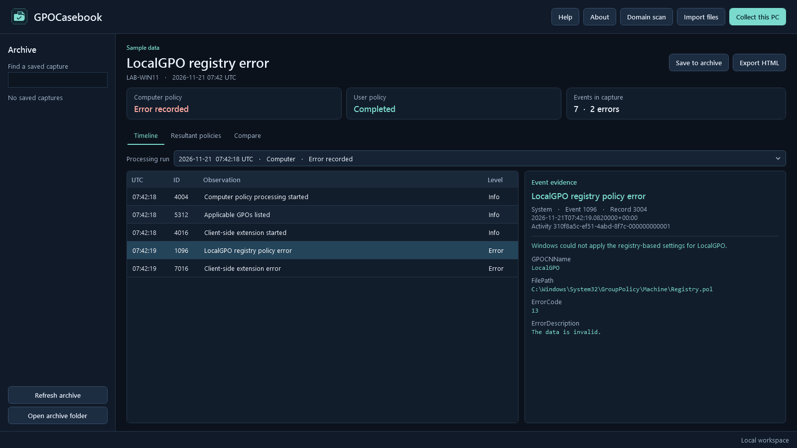
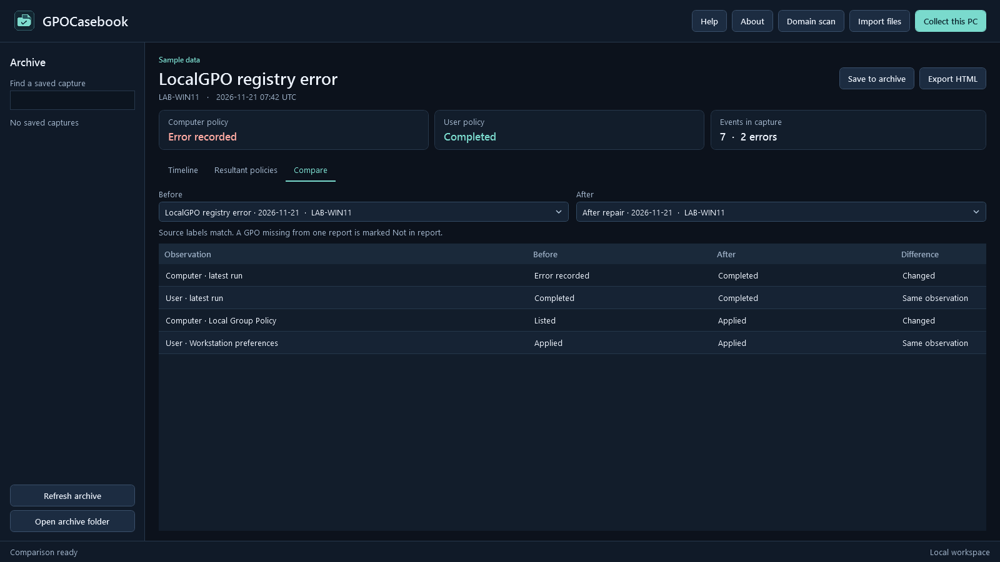
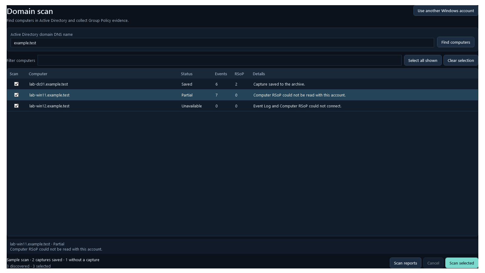

# GPOCasebook

GPOCasebook is a free, local-first Windows workbench for investigating Group Policy failures, comparing before-and-after captures, and exporting evidence that can be reviewed offline.

## Screenshots

| Timeline | Before and after comparison | Active Directory domain scan |
| --- | --- | --- |
|  |  |  |

## What it does

- Collects recent Group Policy Operational and System events from the current computer.
- Captures Resultant Set of Policy (RSoP) evidence through the Windows gpresult tool.
- Imports Group Policy event XML, .evtx exports, and gpresult /x XML files.
- Groups related events into a searchable timeline with channels, record numbers, timestamps, Activity IDs, and recorded fields.
- Saves captures in a local archive and compares the latest User and Computer processing outcomes across two captures.
- Scans selected Active Directory computers with authenticated Windows Event Log and Computer RSoP reads.
- Exports offline HTML reports with a shareable summary mode and an optional detailed mode.
- Keeps routine processing local. The app does not require an account or publisher telemetry.

## Requirements

- Windows 11 x64
- .NET Framework 4.8, available as part of Windows 11
- An account with the required Windows permissions for any local or remote evidence you choose to collect
- Directory, Event Log, DNS, and remote-management access for Active Directory scans

## Run from source

The repository builds on Windows with an installed .NET SDK.

    git clone https://github.com/afrfuniverse/gpocasebook.git
    Set-Location gpocasebook
    .\Build.ps1 -Test
    .\build\GPOCasebook.exe

Build.ps1 -Test compiles the workbench and setup wizard, runs the regression suite, verifies the installer in an isolated temporary directory, checks reinstall behavior, and confirms archive retention.

## Typical workflow

1. Open **Collect this PC** to inspect the last 24 hours of Group Policy evidence.
2. Use **Import files** when you already have event XML, an .evtx export, or an RSoP XML report.
3. Open an event or RSoP snapshot from the timeline, then use **Save to archive** to keep the capture.
4. Use **Compare** to review changes between a capture from before a repair and a follow-up capture.
5. Use **Export HTML** to create an offline report. The shareable summary omits computer labels, policy names, and raw event fields. The detailed option includes internal evidence for controlled sharing.

## Active Directory domain scans

Open **Domain scan**, choose the current Windows identity or the Windows **Run as** prompt, enter the domain DNS name, discover enabled computers, and scan the selected machines. Results are shown per computer, including partial captures and unavailable sources. The scan reads up to 300 recent records from each Group Policy log source within the last 24 hours, with up to four computers in flight.

Remote collection depends on the permissions of the selected Windows account and on the DNS, Event Log, RSoP, and remote-management configuration already present in the environment. GPOCasebook does not edit Group Policy or store Windows passwords.

## Local data and privacy

Captures, archives, scan summaries, and exports remain under the Windows profile or the location you choose. Evidence can contain computer names, domain names, user names present in logs, policy names, file paths, timestamps, and event messages. Review reports before sharing them.

The default shareable HTML export removes named computers, named policies, and raw event fields. The archive and detailed exports retain the evidence required for internal troubleshooting. Read the complete [privacy policy](PRIVACY.md) before collecting or sharing production data.

## Repository layout

- src/ — WPF workbench, domain scan, evidence parsing, archive, comparison, and reporting
- setup/ — offline per-user installer
- tests/ — deterministic parser, comparison, archive, report, and installer checks
- docs/images/ — interface screenshots used in this README and Store listing
- examples/ — synthetic before-and-after XML captures
- store/ — MSIX packaging and Microsoft Store submission notes
- assets/ — application and Store icon resources

## Packaged builds

The source tree is the release source of truth. Build outputs such as .exe, .msix, and temporary verification folders are intentionally kept out of the main branch. Attach reviewed binaries to a GitHub Release when a version is ready, or use the Microsoft Store package workflow in [store/README.md](store/README.md).

## License

GPOCasebook is released under the [MIT License](LICENSE).

## Support

- [Open an issue](https://github.com/afrfuniverse/gpocasebook/issues)
- [Privacy policy](PRIVACY.md)
- [Microsoft Group Policy troubleshooting guidance](https://learn.microsoft.com/en-us/troubleshoot/windows-server/group-policy/applying-group-policy-troubleshooting-guidance)

Built by [Alireza Foroughifar](https://github.com/afrfuniverse).
